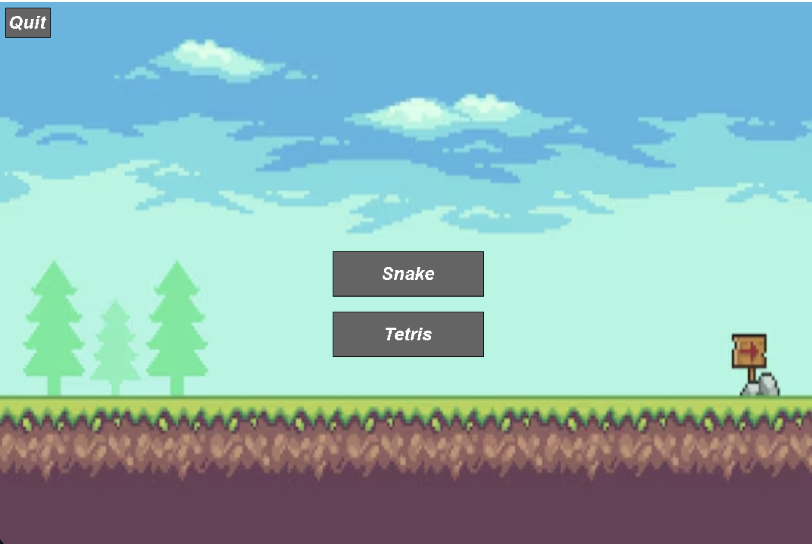
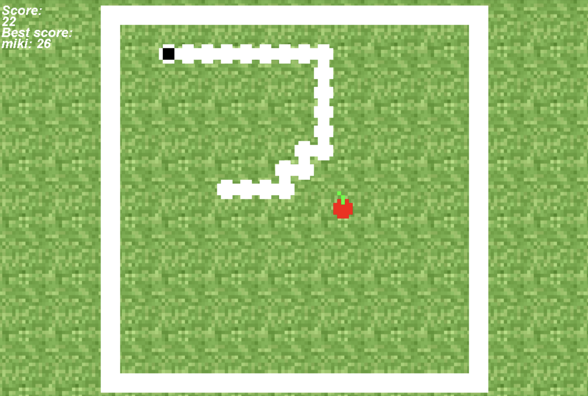
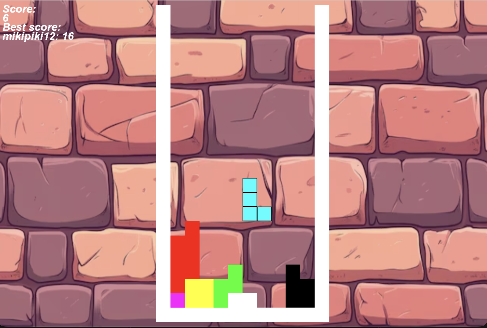

# 2D Games Launcher

A lightweight desktop arcade launcher written in C++20 with [SDL2](https://www.libsdl.org/). The project provides a single menu for launching independently developed games and includes reusable window, button, text, audio, and score-management components.

The repository currently includes:

- **Snake** — a classic grid-based Snake game.
- **Tetris** — a falling-block puzzle game.

Each game is built as a shared library and loaded by the launcher, making the project straightforward to extend with additional games.

## Screenshots

### Main menu


<!--  -->

### Snake


<!--  -->

### Tetris


<!--  -->

## Features

- SDL2-powered windowing, rendering, input, and event handling.
- SDL2_image support for loading game and menu artwork.
- SDL2_ttf support for in-game text and score displays.
- SDL2_mixer support for background music and sound effects.
- A reusable `WindowManager` for shared SDL resources and media loading.
- Mouse-driven launcher buttons for starting games and exiting the application.
- Persistent score storage in `records.csv`.
- Modular game architecture based on shared libraries.
- Separate media directories for the launcher, Snake, and Tetris.

## Requirements

- CMake **4.0 or newer**
- A C++20-compatible compiler
- SDL2
- SDL2_image
- SDL2_ttf
- SDL2_mixer

The commands below use [Homebrew](https://brew.sh/) on macOS:

```bash
brew install cmake sdl2 sdl2_image sdl2_ttf sdl2_mixer
```

The source is cross-platform in principle, but the current top-level CMake configuration links macOS-style `.dylib` game libraries. The build instructions below therefore target macOS.

## Installation and build

Clone the repository and enter the project directory:

```bash
git clone https://github.com/mikipiki123/2D_games_MacOS.git
cd 2D_games_MacOS
```

Build the Snake shared library:

```bash
cd games/snake
cmake .
cmake --build .
```

Build the Tetris shared library:

```bash
cd ../tetris
cmake .
cmake --build .
```

Build the launcher from the repository root:

```bash
cd ../..
cmake .
cmake --build .
```

The commands generate the game libraries and the `gameMenu` executable in the project directory. The launcher expects to be started from the repository root so that it can find images, fonts, audio, and `records.csv` using their relative paths.

## Running the launcher

From the repository root, run:

```bash
./gameMenu
```

Select **Snake** or **Tetris** from the menu. Use the **Quit** button or close the window to exit.

## Project structure

```text
.
├── games/
│   ├── snake/          # Snake shared library and assets
│   └── tetris/         # Tetris shared library and assets
├── images/             # Launcher artwork and screenshots
├── include/            # Shared C++ headers
├── src/                # Launcher and shared component implementations
├── fonts/              # Launcher font assets
├── sounds/             # Launcher music
└── records.csv         # Persistent high-score data
```

## Adding a new game

Games are integrated as shared libraries and connected to the launcher through the same interface used by Snake and Tetris.

1. Add the game under `games/<game-name>/`.
2. Create a CMake target with `add_library(<game-name> SHARED ...)`.
3. Link the game against SDL2, SDL2_image, SDL2_ttf, and SDL2_mixer as needed.
4. Expose the game entry point expected by the launcher, receiving `WindowManager*` and `UserData*` data.
5. Add the library to the top-level `CMakeLists.txt`.
6. Add a launcher button and connect its callback in `src/main.cpp`.
7. Keep the game’s images and sounds in its own `images/` and `sounds/` directories.

When a game exits normally, it can return score data for persistence. An invalid or non-recording result is represented by a score of `-1` and is not written to `records.csv`.

## Troubleshooting

### The launcher cannot find images, fonts, or audio when executes not from root.

Run the executable from the repository root:

```bash
./gameMenu
```

### A game library is missing

requires build in order. Build both game targets before rebuilding the launcher:

```bash
cmake --build games/snake
cmake --build games/tetris
cmake --build .
```
